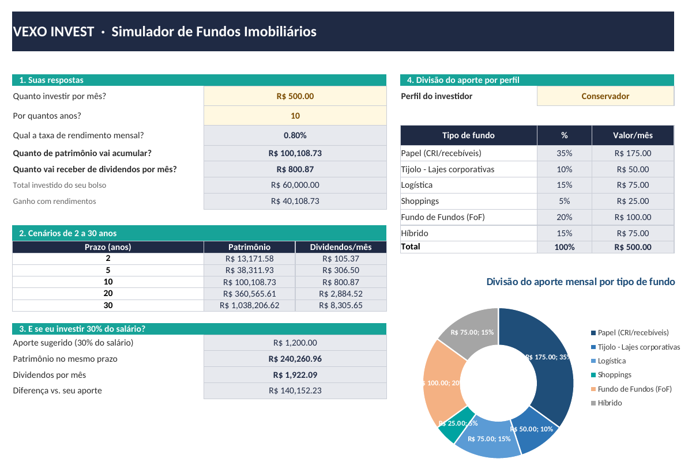
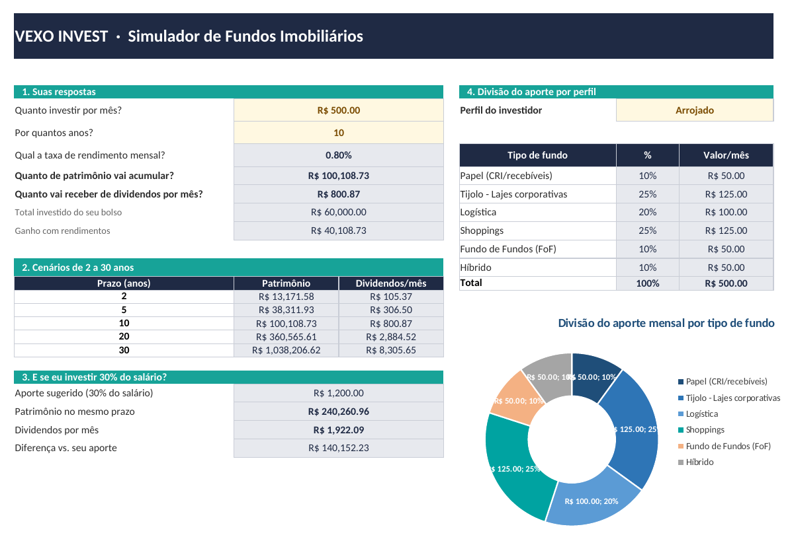

# VEXO INVEST · Simulador de Fundos Imobiliários no Excel

Ferramenta em Excel que simula investimentos mensais em fundos imobiliários (FIIs): do aporte de cada mês ao patrimônio acumulado e aos dividendos que ele gera. Ela foi feita para ser usada **sem saber fórmula nenhuma**. O usuário preenche os campos em amarelo e a planilha calcula o resto. As células cinzas são calculadas e não devem ser editadas.

Projeto desenvolvido no Lab **"Criando uma Ferramenta de Controle de Investimentos com Excel"** da [DIO](https://www.dio.me/), com o Expert Felipe Aguiar.

> ⚠️ Todos os valores do arquivo (salário, aporte, taxa e percentuais por perfil) são **de exemplo**. Eles não são recomendação de investimento.

---

## 📸 A ferramenta funcionando

Mesma simulação (R$ 500/mês, 10 anos, 0,80% a.m.) em dois perfis diferentes. Só a divisão do aporte e o gráfico mudam:

| Perfil Conservador | Perfil Arrojado |
|---|---|
|  |  |

---

## ❓ As 5 perguntas de negócio e onde cada resposta aparece

Todas as respostas ficam na aba **Simulador**, bloco **"1. Suas respostas"**:

| # | Pergunta | Célula | Tipo | Exemplo |
|---|---|---|---|---|
| 1 | Quanto investir por mês? | `C7` (`aporte`) | Entrada | R$ 500,00 |
| 2 | Por quantos anos? | `C8` (`anos`) | Entrada | 10 |
| 3 | Qual a taxa de rendimento mensal? | `C9` → `taxa_mensal` | Vem das Configurações | 0,80% |
| 4 | Quanto de patrimônio vai acumular? | `C10` (`patrimonio`) | Calculada | R$ 100.108,73 |
| 5 | Quanto vai receber de dividendos por mês? | `C11` (`dividendos`) | Calculada | R$ 800,87 |

Logo abaixo, a planilha mostra também o **total investido do próprio bolso** (`C12`) e o **ganho com rendimentos** (`C13`). Isso deixa claro quanto do patrimônio veio dos juros compostos.

---

## 🧮 Como o VF e o PROCV entram nos cálculos

### VF: patrimônio acumulado

```excel
=VF(taxa_mensal; anos*12; -aporte)
```

| Argumento | O que é | No projeto |
|---|---|---|
| `taxa` | Rendimento por período | `taxa_mensal` (mensal, igual ao período dos aportes) |
| `nper` | Número de períodos | `anos*12` (os anos convertidos em meses) |
| `pgto` | Valor aplicado a cada período | `-aporte` (negativo porque é dinheiro saindo do bolso; assim o resultado sai positivo) |

Os **dividendos mensais** saem do patrimônio: `=patrimonio*taxa_mensal`.

O mesmo VF é usado em mais dois lugares:

- **Cenários de 2 a 30 anos** (bloco 2): `=VF(taxa_mensal; $B17*12; -aporte)`. O `$` trava a coluna B, onde estão os prazos, e os intervalos nomeados se comportam como referência absoluta. Assim a fórmula pode ser arrastada para baixo sem se perder.
- **Simulação com 30% do salário** (bloco 3): `=VF(taxa_mensal; anos*12; -aporte_sugerido)`.

### PROCV com chave composta: divisão do aporte por perfil

A tabela de apoio tem uma linha para cada combinação **perfil + tipo de fundo**. Na coluna A fica a **chave composta**:

```excel
=B4&C4      → "ConservadorPapel (CRI/recebíveis)"
```

No Simulador, o percentual de cada tipo de fundo é buscado juntando o perfil escolhido com o nome do fundo:

```excel
=PROCV(perfil&F10; tab_perfis; 4; FALSO)
```

Sem a chave composta, o PROCV acharia sempre a primeira ocorrência do tipo de fundo, que é a do perfil Conservador. Com ela, cada busca é única. O valor em reais é `=aporte*G10`.

O perfil é escolhido numa **lista suspensa** (Validação de Dados apontando para `lista_perfis`). Trocar o perfil atualiza a tabela e o **gráfico de rosca**.

---

## 🏷️ Intervalos nomeados

| Nome | Aponta para | Função |
|---|---|---|
| `aporte` | `Simulador!C7` | Aporte mensal informado |
| `anos` | `Simulador!C8` | Prazo em anos |
| `patrimonio` | `Simulador!C10` | Patrimônio acumulado (resultado do VF) |
| `dividendos` | `Simulador!C11` | Dividendos mensais estimados |
| `perfil` | `Simulador!G7` | Perfil escolhido na lista |
| `salario` | `Configuracoes!C6` | Salário mensal (exemplo) |
| `taxa_mensal` | `Configuracoes!C7` | Rendimento mensal da carteira |
| `pct_sugestao` | `Configuracoes!C8` | % do salário sugerido para aporte (30%) |
| `aporte_sugerido` | `Configuracoes!C9` | `=salario*pct_sugestao` |
| `tab_perfis` | `Apoio!A4:D21` | Tabela perfil × tipo de fundo × % (com chave) |
| `lista_perfis` | `Apoio!F4:F6` | Fonte da lista suspensa de perfis |

---

## 📊 Percentuais por perfil

| Tipo de fundo | Conservador | Moderado | Arrojado |
|---|---:|---:|---:|
| Papel (CRI/recebíveis) | 35% | 25% | 10% |
| Tijolo: lajes corporativas | 10% | 15% | 25% |
| Logística | 15% | 20% | 20% |
| Shoppings | 5% | 15% | 25% |
| Fundo de Fundos (FoF) | 20% | 15% | 10% |
| Híbrido | 15% | 10% | 10% |
| **Total** | **100%** | **100%** | **100%** |

**De onde vieram:** são percentuais **meus, de exemplo**, montados a partir da lógica apresentada nas aulas:

- **Conservador** concentra em **fundos de papel** e **FoFs**. A renda é mais previsível e a diversificação, maior.
- **Arrojado** pesa mais em **tijolo** (lajes e shoppings). Esses fundos são mais sensíveis a vacância e ao ciclo econômico, mas têm mais potencial de valorização.
- **Moderado** fica no meio do caminho.

A aba **Apoio** traz uma coluna de conferência (`=SOMASE(...)`) que confirma que cada perfil soma 100%.

---

## ✏️ O que mudei em relação à ferramenta do Expert

- **Identidade própria:** banner "VEXO INVEST" com paleta própria e blocos numerados (1 a 4) que guiam a leitura.
- **Percentuais próprios** por perfil (tabela acima).
- **Duas linhas extras** nas respostas: *Total investido do seu bolso* e *Ganho com rendimentos*.
- **Simulação com 30% do salário** (bloco 3): compara o patrimônio e os dividendos do aporte sugerido com o aporte informado.
- **Gráfico de rosca** da divisão do aporte, que muda junto com o perfil.
- **Conferência automática** de que cada perfil soma 100% na aba Apoio.

---

## 📁 Estrutura do arquivo

```
simulador-fii.xlsx
├── Simulador       → tela principal (entradas, respostas, cenários, 30% do salário, divisão por perfil)
├── Configuracoes   → variáveis globais (salário, taxa, % sugerido)
└── Apoio           → tabela perfil × tipo de fundo com chave composta + listas
```

## ▶️ Como usar

1. Baixe o `simulador-fii.xlsx`.
2. Na aba **Configuracoes**, ajuste salário e taxa mensal, se quiser.
3. Na aba **Simulador**, preencha o aporte mensal e o prazo (células amarelas).
4. Escolha o perfil na lista suspensa.

---

**Larissa Lourenço · Vexo AI2**
[LinkedIn](https://www.linkedin.com/in/larissalourenco-vexoai2) · [GitHub](https://github.com/vexoai2)
